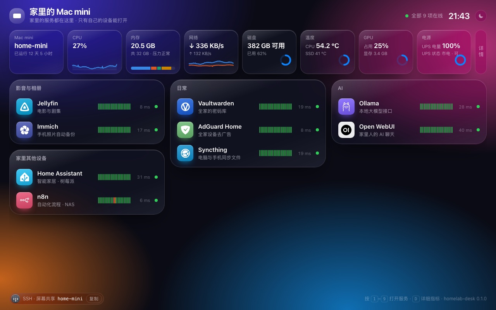
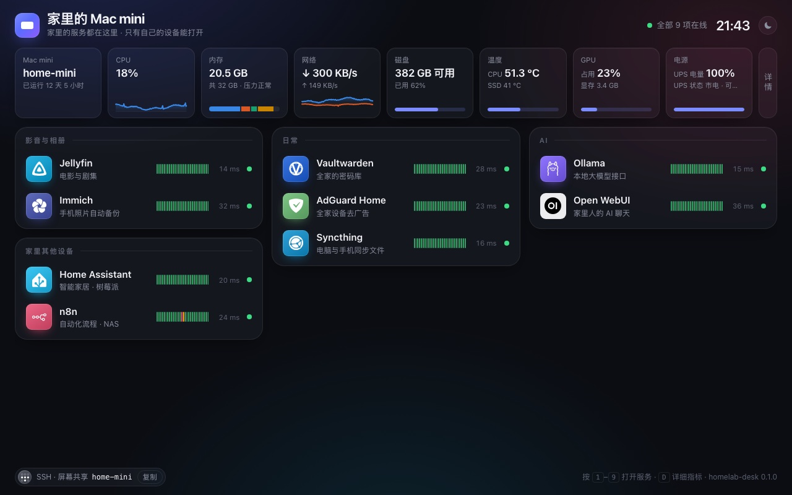
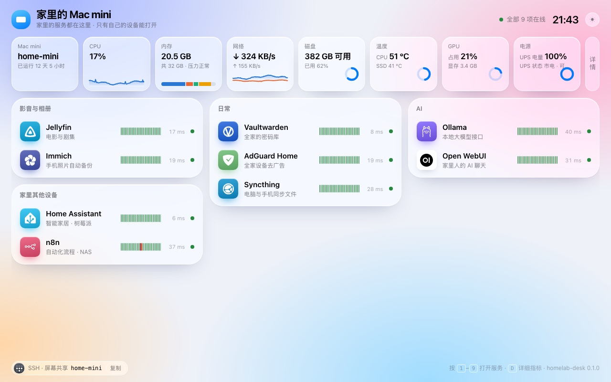
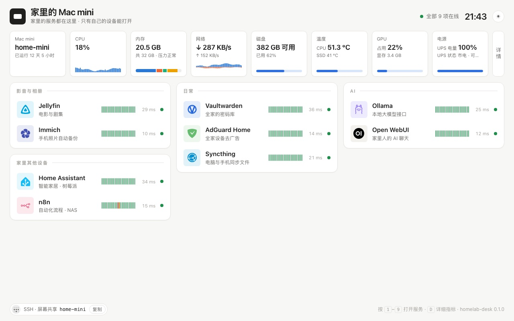
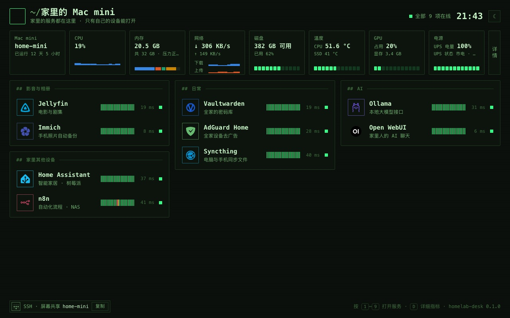
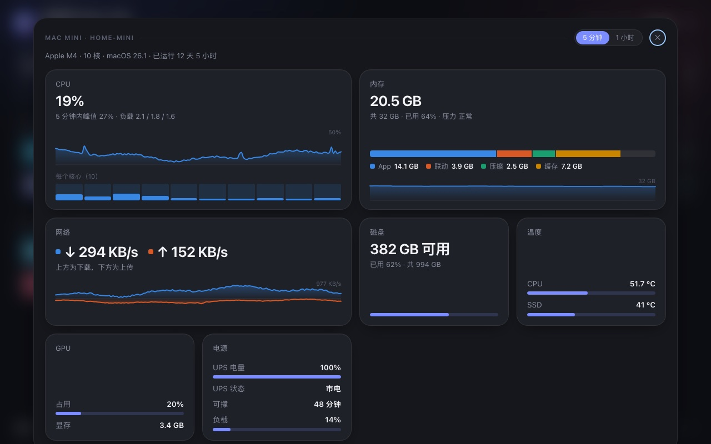
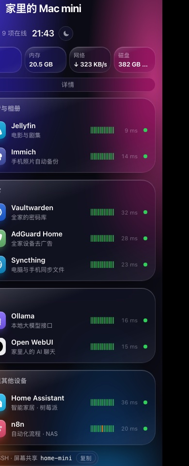

# homelab-desk

[中文](README.md)

A **desk** for every service on the always-on machine at home (Mac mini first, Linux too):

- A memorable name per service: `https://jellyfin.desk.example.com`
- Real HTTPS certificates, renewed automatically
- **Only your own devices can open it** (Tailscale); no ports exposed to the internet
- A live dashboard: each service up/down, response time and last-hour history; the machine's CPU (per core), memory composition and pressure, disk, network, temperatures, GPU and UPS
- A daily health check whose report can go to any notification channel you like
- Set up by a Claude Code / Codex skill in one sentence; adding a service is one sentence too



<table><tr>
<td><br>glass</td>
<td><br>liquid · light</td>
</tr><tr>
<td><br>paper</td>
<td><br>terminal</td>
</tr></table>

<table><tr>
<td><br>detailed metrics (click 详情 or press D)</td>
<td width="30%"><br>phone</td>
</tr></table>

The whole page fits on one screen: a strip of machine metrics on top, your services below, packed tighter as the list grows. Screenshots use demo data: append `?demo` to any deployed dashboard URL.

```
phone / laptop ──Tailscale──▶ desk.example.com ──▶ Caddy (certs, Tailscale-only) ──▶ your services
                                                  └─▶ dashboard page + metrics agent (desk-agent)
```

## How it differs

Homepage, Homarr, Dashy and Glance do the *page*; Uptime Kuma does *monitoring*; Beszel and Glances do *metrics*. homelab-desk does the **whole path from zero to usable**: domain, certificates, private access, page, monitoring and health checks, with an AI walking you through it. If you already run any of those tools, add them as services.

## Getting started

### Let the AI do it (recommended)

```bash
git clone https://github.com/shisaq/homelab-desk ~/homelab-desk
# Claude Code
ln -s ~/homelab-desk/skill ~/.claude/skills/homelab-desk
# Codex
ln -s ~/homelab-desk/skill ~/.codex/skills/homelab-desk
```

Then tell Claude Code or Codex: "Set up a homelab desk with homelab-desk." It checks prerequisites, guides you through the Cloudflare token, creates DNS records, deploys and verifies. The skill is written in Chinese; the AI will talk to you in your language.

### By hand

You need a domain on Cloudflare, Tailscale installed and logged in, and Python 3.9+ (comes with Homebrew's Command Line Tools on macOS).

```bash
cd ~/homelab-desk
# Copy a Cloudflare token first (template "Edit zone DNS" + Zone·Zone·Read, this zone only)
pbpaste | bin/homelab-desk init --domain desk.example.com --email you@example.com --token-stdin
bin/homelab-desk doctor      # check prerequisites
bin/homelab-desk dns         # create desk.example.com and *.desk.example.com (DNS only, grey cloud)
bin/homelab-desk deploy      # generate and enable everything; safe to re-run
```

Open `https://desk.example.com`.

## Commands

| Command | What it does |
| --- | --- |
| `init` | Write `~/.config/homelab-desk/services.yaml` |
| `doctor` | Check Tailscale, token, DNS records, ports, local proxy |
| `dns` | Create / fix the two A records on Cloudflare, always DNS-only |
| `deploy` | Generate the Caddy config and the dashboard, install background services (launchd on macOS, systemd on Linux), wait for certificates |
| `add <name> [host:port]` | Add a service and deploy; catalog services need no address |
| `remove <name>` | Remove a service and deploy |
| `list` / `status` | List services / background service status |
| `catalog [keyword]` | Recommended services |
| `check [--notify]` | Health check; exit code 0 ok, 1 warning, 2 critical |
| `uninstall` | Remove background services (keeps config and certificates) |

Command output and the dashboard are in Chinese for now.

## Configuration

Everything lives in one `services.yaml`; see [examples/services.example.yaml](examples/services.example.yaml). Run `deploy` after editing.

- **Themes**: `glass` / `liquid` (Apple-style liquid glass) / `paper` / `terminal`, each in light and dark. `appearance: auto / light / dark` sets the default; a button in the top-right corner switches it on the fly. Append `?theme=liquid` to the URL to preview.
- **Layout**: on desktop everything fits on one screen. Metrics are a single strip; the big charts live in a detail overlay (press `D`, or append `?detail`). Services are grouped lists that pick one of four densities to fit the screen height.
- **Charts**: each theme has its own chart style — area, bars or text blocks for trends; bars, rings or segments for gauges — overridable under `charts:`. The dashboard shows per-core CPU, memory composition, download and upload as two series, and each service's last hour, with a 5-minute / 1-hour range switch.
- **Plugins**: temperatures, GPU, UPS / battery, check notifications, or write your own. See [docs/plugins.md](docs/plugins.md).
- **Catalog**: 30 recommended services across media, photos, passwords, ad blocking, automation, smart home, AI, file sync, notes, development, monitoring, downloads and reading, each with who it's for, how to install it, and what to watch out for behind a reverse proxy. See [catalog/services.yaml](catalog/services.yaml).

## Why it's built this way

- **Native, not Docker**: Docker on a Mac runs inside a VM that can't see the Tailscale address or read the host's temperatures and GPU. The project itself is just Caddy, a small Python service and a static page. Your services can run anywhere, Docker included; the project only needs `host:port`.
- **DNS-01 certificates**: services only live on Tailscale, so Let's Encrypt can't reach them for HTTP validation.
- **Tailscale-only by source IP**: on macOS a normal user can only listen on 443 on all interfaces, so LAN devices could connect too; Caddy drops anything not from the tailnet.
- **Server-side health probes**: browser cross-origin probes get misread as "down" because of some services' security headers; probing through Caddy on the server also verifies certificates and routing.

Details: [docs/design.md](docs/design.md) (Chinese).

## Platforms

- macOS 13+ (developed and used daily on an Apple-silicon Mac mini)
- Linux (systemd): implemented but not yet tested on real hardware; feedback welcome

## License

MIT, see [LICENSE](LICENSE). Third-party code and icons: [NOTICE.md](NOTICE.md).
